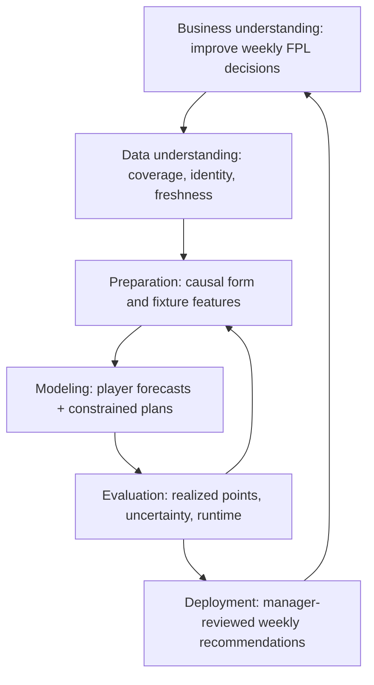

# Frameworks, foundations and sources

This companion to the [stakeholder overview](STAKEHOLDER_OVERVIEW.md) separates implemented
methods, documented lineage, new explanatory mappings and proposed inspiration. A citation
does not prove a method improves our FPL decisions; that requires our own evaluation.

## A lightweight business lifecycle: CRISP-DM

CRISP-DM describes six connected phases: business understanding, data understanding,
data preparation, modeling, evaluation and deployment. We introduce it here as an
**explanatory mapping**, not a claim of historical adoption or certification.
Source: [IBM's CRISP-DM overview](https://www.ibm.com/docs/en/spss-modeler/18.6.0?topic=dm-crisp-help-overview).

*Original project-specific diagram adapted from the six CRISP-DM phases. Arrows indicate
iteration; the weekly monitoring loop is not fully automated.*

| Phase | Project connection |
| --- | --- |
| Business understanding | Useful personal FPL advice, points after transfer costs and manageable effort. |
| Data understanding | Stable player codes, checked events, missing statistics and coverage in `fpl/data/fetch.py`. |
| Preparation | Shifted form, minutes and opponent features in `fpl/features.py`. |
| Modeling | Position forecasters in `fpl/model/`; squad decisions in `fpl/milp/`. |
| Evaluation | Diagnostics, realized scoring and paired comparisons in `fpl/milp/compare_backtests.py`. |
| Deployment | `fpl/run_week.py` supplies advice; the manager acts. Automated monitoring remains incomplete. |

This structure explains the business process without adding a document or software
platform for each phase.

## Prediction followed by constrained optimization

**Implemented:** estimate player points, then pass forecasts into a squad optimization
model. Forecast quality and decision quality are related but distinct. Errors around
captaincy or affordable transfers can matter more than errors for unselected players.

Elmachtoub and Grigas, [*Smart "Predict, then Optimize"*](https://arxiv.org/abs/1710.08005),
provide academic context for evaluating predictions through decision consequences.
**This is a conceptual connection, not historical attribution or an implemented SPO+
training loss.** CatBoost training and empirical downstream selection remain separate.

**Documented lineage:** `fpl/milp/optimize.py` identifies its formulation as following
Kristiansen et al., carried forward from the thesis-era optimizer. The archived
[project report bibliography](archive/reports/2026-07/main.typ) records Kristiansen,
Gupta and Eilertsen (2018), *Developing a forecast-based optimisation model for Fantasy
Premier League*. This is repository-recorded lineage; this guide does not independently
verify every formulation term against the original thesis.

Rolling-horizon planning uses the current decision and replans with new information.
A limited horizon does not establish season-optimal play. Bench and vice weights are
planning heuristics; the objective is not an exact joint expected-outcome model.

## Time-ordered evaluation and experimental discipline

Hyndman and Athanasopoulos describe rolling-origin evaluation in
[*Forecasting: Principles and Practice*](https://otexts.com/fpp3/toolbox.html#time-series-cross-validation). This is a
methodological reference for time order, not proof that our historical inputs reconstruct
every deadline perfectly.

Our implementation uses chronological training, shifted features and origin-based
prediction. A multi-week decision must use forecasts available at its origin, rather
than forecasts rebuilt after intermediate outcomes. Historical roster, price and fixture
availability assumptions remain limitations of each comparison.

The research contract adds matching inputs, predeclared windows/seeds, provenance and
preserved negative results. Paired weekly differences and moving-block bootstrap intervals
help quantify uncertainty while allowing short-range dependence. Block choice, sample
size and repeated historical inspection limit interpretation. An interval is not a
guarantee of future gain, and a bootstrap win fraction is not a null-hypothesis p-value.
Implementation: [`compare_backtests.py`](../fpl/milp/compare_backtests.py).
Binding protocol: [CLAUDE.md](../CLAUDE.md).

## Academic algorithms, FOSS and direct reuse

| Source | Role and actual use | Boundary |
| --- | --- | --- |
| [CatBoost papers](https://catboost.ai/docs/en/concepts/educational-materials-papers) | Gradient-boosted trees are the production forecasting family. | The algorithm does not prove our configuration is best for FPL. |
| [Vaastav archive](https://github.com/vaastav/Fantasy-Premier-League) | Historical ingestion source. | The archive states weekly updates stopped after 2024-25; active-season admission uses official data, not an assumed current archive. |
| [Official FPL API](https://fantasy.premierleague.com/api/bootstrap-static/) | Metadata, histories, prices, fixtures and availability via related endpoints. | Mutable input, not preserved historical information vintages. |
| [PuLP](https://coin-or.github.io/pulp/) and [HiGHS](https://highs.dev/) | Model expression and solving; optional adapter uses HiGHS directly. | Optimality is relative to supplied objectives, constraints and forecasts. |
| [Pinned Open FPL Solver](https://github.com/solioanalytics/open-fpl-solver/tree/ec65f5e2b2be34441cb4b2a9efafea1ec0fe3b79) | Optional vendored solver core with preserved upstream bytes, patches and hashes. | Not the whole upstream application; see [adapter guide](OPEN_FPL_ADAPTER.md) for license wording and measured limits. |
| [Partner's Model Lab](https://github.com/EmiandTobrav/FPL/tree/db1a9e7dbeefb22aa310747cb3064e9c5e4ecf71/model_lab) | Reviewed inspiration: bounded experiments, artifact receipts, result cards and outcome-blind decisions. | Generic experiment patterns adapted in our independent Training Ground implementation; no partner source, dataset, score or conclusion is imported by this documentation. Access may require permission. |

The reference lab describes result cards, completion receipts, bounded configurations
and saved decisions preceding outcome access. Our [bounded runner](../fpl/research_runner.py),
[playground](../fpl/playground.py), [scorecard](../fpl/scorecard.py) and
[replay](../fpl/milp/replay.py) apply related general ideas within this repository's
existing components. Their existence does not establish complete outcome-blind
execution; the [pilot evidence](../experiments/unified_scorecard_2026-10-18/REPORT.md)
keeps that check NOT ASSESSED. This is pattern-level inspiration, not a copied lab.

Python, pandas and NumPy implement data processing; Optuna supports bounded parameter
search; pytest checks correctness. Git/GitHub preserve changes and track work. AI coding
agents assist implementation and audits; their output still requires verification.

Reuse should isolate a useful component, preserve attribution and licensing, and test
compatibility with our identity, scoring and information-time contracts. An academic
idea should become a small falsifiable experiment before becoming a dependency.

## Finance and decision-analysis concepts

| Concept | Interpretation | Status |
| --- | --- | --- |
| Constrained allocation | Squad under budget, position and club limits. | Implemented MILP; portfolio language is an analogy. |
| Transaction costs | Paid transfers reduce points; compare gross/net consistently. | Implemented; explicit comparison contracts reject mixed accounting, while old output conventions require labelled recovery. |
| Opportunity cost | A purchase uses budget; a chip used now cannot be saved. | Partly represented by multi-period constraints; no calibrated general shadow-value model. |
| Uncertainty/downside | Forecasts can be wrong; sensitivity can be informative. | Probabilistic research exists; joint risk reports are not production features. |
| Incremental value | Compare a proposed plan with retaining the squad under identical assumptions. | Recommended report design, not a complete existing capability. |

We do not claim Markowitz portfolio optimization, financial return modeling, CVaR
optimization or a learned full-season manager. A framework earns its place by clarifying
a decision, an assumption or a test.

## Using these references responsibly

The CRISP-DM diagram is a new project-specific explanation of its six phases. The
predict-then-optimize paper supplies conceptual context; this system does not train
with SPO or SPO+ loss. The Kristiansen attribution is recorded repository lineage,
not an independently reproduced thesis formulation. Open FPL is direct vendored
reuse with its notices preserved; the partner lab is inspiration for general
experiment practices. These are different kinds of attribution.

Source review for this guide: 2026-10-18. Public author/publisher pages and the
pinned partner-lab README were checked; the pinned Open FPL manifest, preserved
license and local formulation/bibliography were checked in this repository. Some
web documentation endpoints restrict automated access; their publisher search
records support the descriptive framework mapping. No source's published result
is treated as measured evidence of improvement in this project.
