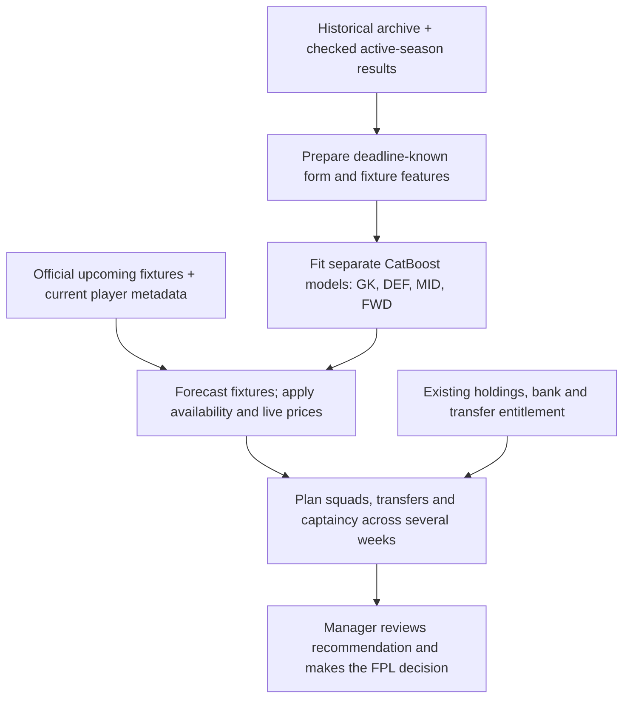
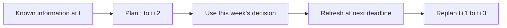
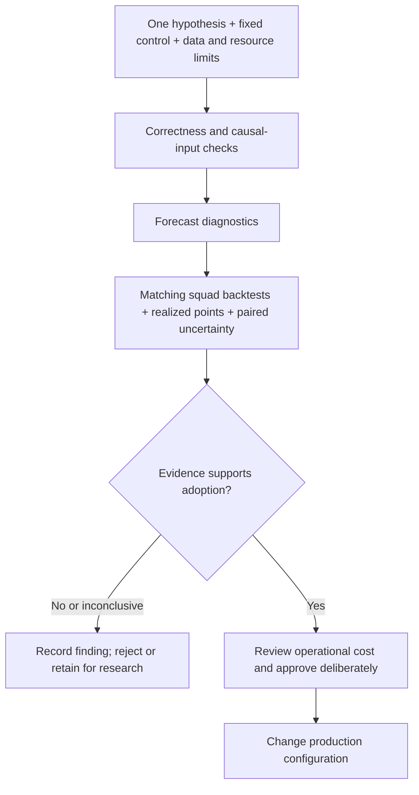
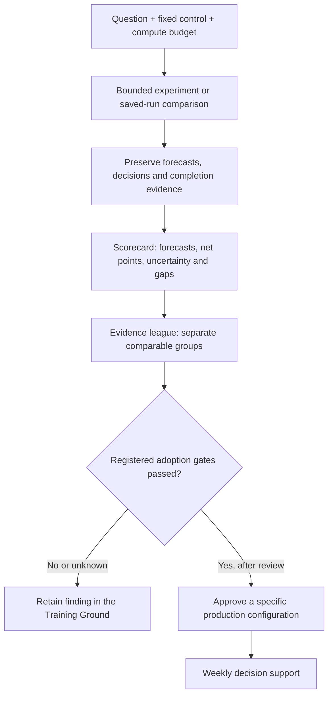

# FPL decision support: from data to a weekly plan

## Purpose and audience

This is a personal hobby project with a practical ambition: make better Fantasy Premier
League decisions and compete with friends. Research helps discover improvements;
statistical evaluation helps avoid adopting changes that merely look convincing.
Demonstrating business analytics and financial reasoning is a useful secondary benefit.

The system combines **prediction** (what might players score?), **optimization** (which
legal plan makes best use of the budget?) and **evaluation** (did a change improve the
decisions?). The manager reviews and executes recommendations; the pipeline does not
submit transfers to FPL. Better decisions do not guarantee better results every week.

This guide is for managers, collaborators and business stakeholders.
[Frameworks and sources](FRAMEWORKS_AND_SOURCES.md) explains the foundations.
[CLAUDE.md](../CLAUDE.md) remains the authority for operating and research rules.

## The decision we are trying to improve

| Decision | Information and trade-off |
| --- | --- |
| Keep or transfer a player | Forecast points across the horizon, price, free transfers and paid-transfer hits. |
| Select XI and bench | Formation, forecast points and player availability. |
| Captain and vice | Captain upside and a legal fallback; forecasts remain uncertain. |
| Use or preserve a chip | Immediate gain versus future opportunities, subject to backend rule support. |

A chip is a limited-use FPL boost, such as a Wildcard or Triple Captain.
GK, DEF, MID and FWD mean goalkeeper, defender, midfielder and forward.

The highest-scoring player is not automatically the best purchase. Buying him can consume
money needed elsewhere or incur a transfer hit. The optimizer evaluates combinations
under constraints rather than selecting a list of stars.

## How the weekly system works

*Figure 1. Implemented weekly pipeline, simplified for explanation. The driver
requires an open deadline and explicit transfer entitlement for an existing
team. Public picks still need checking against the manager's current private state.*

1. **Collect:** `fpl/data/fetch.py` combines Vaastav history with official active-season
   results admitted only after their events are checked.
2. **Prepare:** `fpl/features.py` calculates recent form, minutes and opponent context.
   Historical player-derived features use earlier rounds; double-gameweek fixtures
   share the same deadline-known form.
3. **Predict:** `fpl/model/train.py` fits position-specific models. Production selects
   `single:catboost`; alternatives are research candidates. Models refit during a weekly
   run. Effective parameters depend on compatible artifacts: absent production files
   mean defaults, not reproduction of a tuned historical control.
4. **Plan:** `fpl/milp/optimize.py` expresses squad decisions as a mixed-integer linear
   program (MILP), normally solved with HiGHS through PuLP. An optional Solio adapter
   has separate modern-rule support and independent output checks. A solver optimum
   means the best plan under its encoded inputs and rules, not a guaranteed FPL gain.

### Why plan several weeks ahead?

*Figure 2. Rolling-horizon planning, illustrated with three weeks. Future plans are
conditional recommendations, not commitments or guaranteed outcomes.*

## How we decide whether an experiment is useful

*Figure 3. Existing research requirements summarized as a decision process. This
summarizes the bounded experiment runner and review requirements; production
promotion is never automatic.*

Mean absolute error (MAE) describes typical forecast error; root mean squared error
(RMSE) gives larger misses more weight. Both help diagnose predictions. They cannot
establish that the selected squad
earns more points. Adoption therefore requires downstream realized-point evidence with
matching controls and paired confidence intervals under the registered protocol. Gross
points and points after transfer hits must be labelled and compared on the same basis.

Historical research uses a separate hash-validated frozen dataset. Live operation refreshes
mutable inputs. Standard backtests can give future planning weeks information unavailable
at the original deadline; origin-based forecasts freeze form at that deadline and are the
more deployment-relevant comparison. Origin-frozen form does not prove that prices,
fixtures or player registrations were known at that deadline. An opt-in capture-price
replay addresses part of that boundary; its blank-forecast planning and exact-deadline
evidence remain incomplete. Repeatedly inspected periods are not fresh holdouts.

Tests establish software behaviour; backtests provide historical decision evidence;
prospectively recorded decisions test live use. The weekly command alone does not create
a prospective experiment.

## The Training Ground and the weekly system

The Training Ground is the controlled playground for trying an idea against a fixed
control. It reuses the forecasting, optimization and scoring components. It can run
bounded standard/origin experiments or compare preserved outputs without refitting.
A research result does not flow into weekly use merely because it wins a small test.

*Figure 4. The league organizes evidence; it does not approve models. Exhibitions,
unverified comparisons and incomplete attempts remain visible without a rank.*

A saved stable-ID decision can be settled separately against observed outcomes.
Evidence-backed retrospective blanks, financial arithmetic and price-input checks
answer different questions; passing one does not pass the others. The unified
scorecard therefore keeps measured results, recorded solver claims and unknown
checks separate. A file hash identifies preserved bytes; it does not prove the
original data was available before a deadline.

**Measured example:** the four-round origin capture-price pilot scored 203 candidate
versus 197 control net points. The paired 95% interval for the difference was
[-8, +11], so it did not establish an improvement. It remains unranked and cannot
justify promotion. These are modern-rule engineering results on already inspected
historical forecasts, not actual historical-rule or live performance claims.
[The preserved scorecard](../experiments/unified_scorecard_2026-10-18/REPORT.md)
shows forecast diagnostics and the evidence gaps together.

See [the Training Ground guide](TRAINING_GROUND.md) for commands and receipts.
A dashboard is a separate product story, [issue #20](https://github.com/Nysgjerrigper/nytt-fpl-forsok/issues/20);
structured scorecards and league data already provide inputs for it.

## A business and finance interpretation

This is a resource-allocation problem: allocate a limited budget, compare alternatives,
account for transaction costs and revisit decisions as information changes. The squad
can be viewed as a constrained portfolio, but FPL points are not financial returns and
this is not a trading system.

**Illustrative example, not a project result:** over the same three-week horizon, keeping
a player is forecast to earn 14 points and replacing him 19. A four-point hit leaves a
simple expected incremental gain of `19 - 14 - 4 = 1` point before other squad effects.
That small margin deserves more scrutiny than the headline five-point gain. It does not
state the probability that the transfer pays off.

Transfer costs and budget constraints are implemented. Calibrated payback probabilities,
joint downside scenarios, concentration reports and risk-aware optimization are possible
extensions, not current production capabilities. Chip support does not establish a
calibrated estimate of chip opportunity value.

## Capabilities and limits

| Status | Capability |
| --- | --- |
| Implemented weekly path | Causal features, CatBoost refits, live fixture/price/availability overlays and rolling-horizon recommendations. |
| Operational safeguards | Open-deadline and horizon checks, explicit current free transfers, unknown-owned-player rejection and strict solver-result admission. |
| Implemented Training Ground | Bounded runner, preserved-run comparisons, scorecards, evidence league, stable-ID snapshots, strict settlement and no-chip financial audit. |
| Opt-in research integration | Pinned Solio core and origin capture-price replay; legacy remains the default backend. |
| Research only | Alternative experts, probabilistic interfaces and history-based cold-start priors; availability in code does not establish FPL gain or promotion. |
| Remaining product work | Fully verified replacement owner-state input, complete live run bundles/monitoring and dashboard. |

Public picks and bank describe the latest passed deadline. They cannot confirm transfers
made since then, private selling prices or remaining chips. The driver requires the
manager's current free-transfer count (0–5), rejects unknown owned players and warns
that owner state still needs verification. It does not yet accept a fully verified
replacement owner-state document. Requested whole-round blanks remain unsupported.

New players without Premier League history remain a forecasting gap. An opt-in research
interface supplies empirical team-position priors, but the default weekly CLI does not
add those players. Its descriptive spread is not calibrated uncertainty, and downstream
FPL improvement has not been demonstrated. Availability scaling is also a heuristic.

The legacy solver rejects unqualified solutions rather than accepting an objective
value alone. Native HiGHS proof and independent output/financial checks have distinct
scopes. CBC fallback carries a weaker, explicitly labelled solver assessment; recorded
Optimal status alone does not establish a complete independent FPL legality certificate.

Legacy transfer banking and chip policy differ from the optional adapter's modern rule
handling. Its first matched static-price comparison was slower and point differences
were inconclusive. See [the adapter guide](OPEN_FPL_ADAPTER.md) for the exact contract
and preserved results; historical controls are not promises of future performance.

## How to judge progress

Can the recommendation be trusted as a legal plan for the actual team? Does it improve
realized net points against a matching control? Is its runtime and maintenance cost
reasonable for a hobby?

The intended improvement loop is to preserve a recommendation, review checked outcomes,
identify a weakness and test one bounded hypothesis. Research recording, scorecards
and saved-decision audits are implemented. Complete automated live recording and
monitoring are still proposed. AI assists implementation and investigation; checked
code, controlled comparisons and human judgment support conclusions.

See [README](../README.md) for setup, [RESEARCH_LOG.md](../RESEARCH_LOG.md) and
[the experiment registry](../experiments/results.csv) for evidence, and
[GitHub issues](https://github.com/Nysgjerrigper/nytt-fpl-forsok/issues) for work and blockers.
