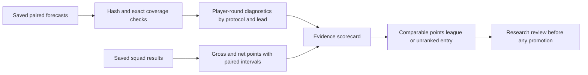

# The Training Ground

The Training Ground is our offline playground for checking ideas before they reach
**Matchday**, the configured weekly system. Its first version compares saved squad
backtests, generates scorecards and maintains separate descriptive league tables.
It does not yet train models, orchestrate ablations, launch the optimizer or promote
anything to production. Those connections belong to the existing research-runner work.



## Try a synthetic exhibition

Use the project's Python environment from the repository root:

```sh
python -m fpl.playground init-demo /tmp/fpl-exhibition
python -m fpl.playground validate /tmp/fpl-exhibition/spec.json
python -m fpl.playground run /tmp/fpl-exhibition/spec.json
python -m fpl.playground report experiments/runs/synthetic-exhibition/first
python -m fpl.playground league
python -m fpl.playground league --json
```

The demo directory must be new. Scores are deliberately synthetic and the result is an
**EXHIBITION**, never model-selection evidence. The league leaves its rank blank.
The example requires no API access, frozen CSV, model fitting or solver run.

## Compare saved backtests

A version-1 specification has the following structure. Replace placeholder hashes with
SHA-256 digests of the actual bytes. Paths resolve relative to the specification file.

```json
{
  "schema_version": 1,
  "id": "saved-comparison",
  "purpose": "historical_reanalysis",
  "hypothesis": "Re-examine preserved candidate and control outcomes after transfer costs.",
  "metric": "actual_net_points",
  "candidate": {
    "name": "candidate",
    "input": {"path": "candidate.csv", "sha256": "REPLACE_WITH_ACTUAL_SHA256"}
  },
  "control": {
    "name": "matching-control",
    "input": {"path": "control.csv", "sha256": "REPLACE_WITH_ACTUAL_SHA256"}
  },
  "bootstrap": {"n_boot": 10000, "block_len": 3, "seed": 0}
}
```

Use `framework_validation` for wiring checks and `historical_reanalysis` for saved
historical outcomes. Neither purpose permits model selection or automatic promotion.
Prospective rounds beyond the tracked frozen cutoff are refused. Previously inspected
and spent windows do not become fresh holdouts because we produce a new report.
The frozen cutoff is read from the tracked manifest; real fitting still requires the
separately restored, SHA-admitted dataset.

Quantile and bucket research entrypoints now use that same frozen snapshot rather
than the mutable weekly dataset. They verify the complete source bytes first, then
retain raw history only through the requested evaluation end (or tuning cutoff)
before constructing features. Earlier rows remain available for training and causal
form features. Static training must finish before the evaluation window. Bucket
tuning cannot exceed `config.TUNING_TRAIN_MAX_GW`; evaluation and spent rounds are
not admitted to its search. A missing or changed frozen snapshot stops the run.
This input validation does not fit models, validate a new result or promote a candidate.

## Explicit forecast recipes

The standard and origin forecasting APIs accept optional keyword-only `params_by_pos`
and `seed`. Supply both to bypass ambient tuned files. Each position needs exactly
the positive-weight registered members in its strategy, with a parameter dictionary
for each member. `resolve_fit_recipe` fills registered constructor defaults, preserves
the member's named loss/objective and applies the declared seed. Conflicting loss or
seed overrides fail before any member fits.

```python
from fpl.model.recipes import resolve_fit_recipe

positions = ("GK", "DEF", "MID", "FWD")
weights = {pos: {"catboost_mae": 1.0} for pos in positions}
overrides = {pos: {"catboost_mae": {"depth": 6, "iterations": 300,
                                  "learning_rate": 0.05}} for pos in positions}
resolved = resolve_fit_recipe(weights, overrides, seed=0)
# Pass params_by_pos=resolved, seed=0 and weight_strategy="single:catboost_mae"
# to walk_forward_predictions or origin_based_predictions.
```

Record the returned complete recipe, ordered features and runtime/library/source
identity in the experiment manifest. A recipe alone does not establish provenance.
The explicit forecast path currently supports single-member strategies, without
blend-weight fitting, level calibration or MID gates. Features must be unique,
present and exclude raw outcome labels; the research runner must additionally
admit the causal feature set and data window. Calling without either new option
keeps the existing production/tuned-artifact fitting behavior.

Each backtest needs one row per `gameweek` and finite `actual_total_points` (gross).
Net comparisons also require nonnegative integer paid transfers in `alpha`; a supplied
net column must agree with gross minus hits. Scoring labels must match if declared;
both absent means historical **UNVERIFIED** evidence. Missing hit counts are not zero.

For strict declared comparability, add a `contract` record with `path` and `sha256` to
both candidate and control. The format is documented in
[Backtest comparison contracts](BACKTEST_COMPARISONS.md). Reanalysis with contracts
requires contracts labelled `registered_research`; a framework manifest cannot be
relabeled to enter a ranked historical competition. Contract validation alone does
not prove that a study was registered in advance or that the decisions were valid.

## What is saved?

```text
experiments/runs/<experiment-id>/<attempt>/
  started.json
  spec.json
  candidate.csv
  control.csv
  candidate-contract.json / control-contract.json   # when supplied
  candidate-forecasts.csv / control-forecasts.csv   # when supplied
  comparison.json
  scorecard.json
  REPORT.md
  complete.json OR failed.json
```

Generated runs are ignored by Git. The completion receipt hashes the required results,
input snapshots and specification. Source and reporting-runtime identity are recorded.
Original model-fit time, failure rate, calibrated uncertainty, independent legality
and native solver proof remain explicitly unmeasured/unassessed by the reporting adapter.
Forecast diagnostics are measured only when both pinned panels are supplied.

## Adding forecast diagnostics

Add an optional `forecasts` object to the experiment specification:

```json
"forecasts": {
  "information_protocol": "standard",
  "grain": "player_round",
  "population": "Preserved optimizer common pool, including zero-filled rows",
  "candidate": {"path": "candidate-predictions.csv", "sha256": "<actual SHA-256>"},
  "control": {"path": "control-predictions.csv", "sha256": "<actual SHA-256>"}
}
```

Both panels need stable positive integer `player_id`, global `GW`, `position`,
`predicted_total_points` and `actual_total_points`. Their entire coverage, positions
and outcomes must match; the adapter never silently intersects different populations.
The declared rounds must exactly match the decision comparison. If strict comparison
contracts are present, their protocol and bound prediction hashes must also match.
Otherwise the forecast-to-decision linkage remains **NOT ASSESSED**.

Declare `grain: "fixture"` only for fixture rows, with a positive integer `fixture`
identifier. Predictions and outcomes are summed into player-rounds before evaluation.
Declare `player_round` for already aggregated exports; original fixture counts then
remain unknown. A common optimizer pool can contain zero-filled rows; label this in
`population` and do not present these diagnostics as recovered original model coverage.

The adapter reuses `fpl.model.metrics` for MAE, RMSE, signed bias, aggregate calibration,
within-position/gameweek Spearman and top-ranked player capture. It reports per-position
support, undefined/skipped rank groups and tied top predictions. Ties use the lowest
stable player code. Undefined ratios become JSON `null`; negative actual points can
produce ratios outside [0, 1], which are preserved. Capture is a ranking diagnostic,
not realized captaincy points. MASE stays **NOT MEASURED** without validated training-only
scales and refit-cutoff lineage; evaluation outcomes are never used to estimate a scale.

For `information_protocol: "origin"`, both panels also need `origin_gw`. Results are
separated by lead (`GW - origin_gw`, with zero meaning the origin's current target).
Repeated target outcomes are not pooled into one overall score. Standard forecasts
remain separate from origin forecasts and do not establish deployment-honest evidence.
These diagnostics do not change league ranking or promotion eligibility.

The JSON and report show the same points, difference, interval and evidence status.
The comparator supplies all point-accounting and statistical calculations. The positive
bootstrap fraction is not a probability of future superiority; the sign test has an
independence assumption and interval width depends on block choice.

The first attempt is called `first`. An unchanged completed attempt is reused only after
verification. A failed or interrupted attempt remains preserved. Retry deliberately:

```sh
python -m fpl.playground run experiment.json --attempt retry-1
```

Do not delete failed runs to force a restart. Reporting a saved completed run verifies
its captured outputs and does not require the original external paths to still exist.
Rerunning preflight does require the pinned original inputs. Contract snapshots retain
their original relative references: these are not complete portable research bundles.

## How the league works

- **CONTRACT_VALIDATED:** descriptive point ranks only within a matching historical
  cohort: same metric, control CSV, control input/source bytes, context and intervention.
- **EXHIBITION:** synthetic/wiring checks, visible but unranked.
- **UNVERIFIED:** historical comparisons without sufficient contracts, visible but unranked.
- **FAILED / INCOMPLETE:** preserved attempts, visible without invented scores.

Tied totals share a rank. Identical observations from retries appear once, rather than
counting as extra evidence. Standard and origin contracts, different windows, controls,
price/rule settings and gross/net metrics cannot share a ranked cohort.

A first-place entry is not automatically the champion. Native optimality, legality,
causal validity, seed stability and the registered promotion gate remain separate.
The configured Matchday strategy stays `single:catboost`.

## Run a bounded forecast experiment

`fpl.research_runner` connects the existing forecast, optimizer and scorecard APIs.
Start with a matched CatBoost MAE/RMSE contrast, or keep the same model on both arms
and remove a predeclared feature subset. Changing both factors together is rejected.
Plans contain resolved parameters, ordered features, a seed, source/data/runtime
identities and fit/solve/time budgets. Preparing a plan does not fit models.


```sh
python -m fpl.research_runner prepare --dataset /path/to/frozen/master_dataset_gw231.csv \
  --start-gw 141 --end-gw 144 --output /path/to/plan.json
# Register the plan and its hash in the research issue before execution.
python -m fpl.research_runner run /path/to/plan.json \
  --dataset /path/to/frozen/master_dataset_gw231.csv --output /path/to/new-attempt
python -m fpl.research_runner report /path/to/new-attempt
```

Selection diagnostics and historical evaluation must each remain wholly within their
registered windows. Earlier history is retained; rows after the target window are
removed before features. Spent and prospective windows are rejected. The same frozen
bytes, code and library versions must still match at execution.

The worker saves all four standard/origin candidate/control forecast panels before
any optimizer run. Each actual fit has start/completion receipts including training
rounds and fitted parameters. Corrected net points and paired intervals accompany
forecast accuracy, calibration and ranking diagnostics. HiGHS must prove optimality
for every encoded MILP. A timeout or error preserves a failed attempt without retries.
Completed reports verify every captured file before displaying results.

These initial runner comparisons remain **UNVERIFIED** and unranked: their manifests
do not yet establish independent FPL legality, an outcome-blind interface or promotion
contracts. Observed historical windows are not fresh holdouts. A four-round pilot
checks the execution path; it cannot establish which model should run in Matchday.

## Where the next connections belong

The shared scorecard is deliberately conservative: saved squad CSVs alone do not
establish original execution telemetry. Optional forecast panels and runner receipts
fill the sections they measure, without interpreting missing evidence as a pass.
Research definitions can live under
`experiments/specs/`; the results registry and research log remain the evidence index.
GitHub issues remain the work tracker, with no separate roadmap/status file here.

The legacy decision snapshot records **settlement_completed=false**, not a guarantee
that outcomes were inaccessible. The historical optimizer loads a CSV containing actuals;
a genuine outcome-blind interface and independent replay audit require further work.
The UI and these reports must not manufacture that stronger claim.
